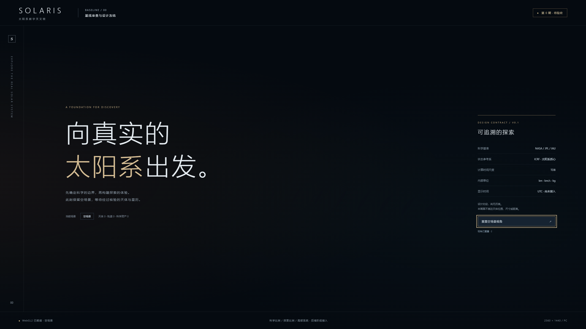

# SOLARIS 第 0 期验收材料

交付日期：2026-10-29（Asia/Shanghai）。冻结版本：v0.1，状态：**第 0 期已交付，等待用户验收；未进入第 1 期**。

## 本期实现与边界

初始仓库为空、无提交、无旧依赖或可复用代码。已创建 `codex/solaris-phase-0` 安全分支，完成仓库审查、架构差异表、科学数据契约、来源矩阵、36 项待采集资产记录、视觉规范、质量档位、验证策略与风险登记。另交付本地 WebGL2 空场景，含相机、resize、重置反馈与初始化失败提示。

没有导入天体数值、星历、科学贴图、轨道或实验逻辑。未实现时间换算、真实比例切换、相机相对坐标算法、天体搜索、科普或物理积分。设计契约不等于运行功能。两张 PNG 保持原样，未裁剪、未当背景或纹理，浏览器资源记录只有本地 JS/CSS。

## 材料入口

| 材料 | 文件 |
| --- | --- |
| 仓库状态、架构差异、修改模块与复用结论 | [01-基线审查](01-基线审查.md) |
| 时间/坐标/单位/来源/缩放/隔离架构 | [02-科学架构与数据源](02-科学架构与数据源.md) |
| 两张参考图、视觉规范、质量档位、资产处理规则 | [03-视觉与资产冻结](03-视觉与资产冻结.md) |
| 科学验证计划、分期依赖、风险登记 | [04-验证策略与风险](04-验证策略与风险.md) |
| 类型契约与规范化状态 Schema | [contracts.ts](../../src/science/contracts.ts)、[JSON Schema](../../schemas/ephemeris-state.schema.json) |
| 来源/资产/参考图哈希登记 | [source-registry](../../data/source-registry.json)、[asset-manifest](../../data/asset-manifest.json)、[reference-manifest](../../data/reference-manifest.json) |
| 依赖实际版本/许可证及漏洞检查 | [dependency-audit](dependency-audit.json)、[npm-audit](npm-audit.json)、根目录 package-lock.json |
| 命令实录与机器可读浏览器结果 | [verification.txt](verification.txt)、[browser-checks.json](browser-checks.json) |

## 科学数据来源与有效时间

数据设计以 NASA/JPL/IAU 官方文档为依据，具体链接及核验状态在来源矩阵。USGS 检索入口本次不可访问，保留未核验候选状态。没有从概念图抄录数值。

本期科学数据导入数为 0，正式资产批准数为 0。**有效时间范围未建立；km/AU 科学误差尚未测量，当前不适用。**后续必须下载并校验数据、时间内核及覆盖交集，才能开放日期范围和报告精度。

## 实际检查结果

| 检查 | 真实结果 |
| --- | --- |
| `npm run check:contracts` | 15 项通过，含错误单位、时间/坐标混用、来源缺失、实验/旧字段混入等反例；使用合成 fixture，不是科学精度测试 |
| `npm run build` | TypeScript 与 Vite 构建通过；有主 JS 约524 KB（gzip约131 KB）的体积警告，尚未做代码拆分 |
| `npm audit --json` | 本次登记的总漏洞数0；快照结果不保证未来仍为0 |
| Chrome 155 / Edge 156 | Windows，真实无头浏览器，WebGL2 可用；DPR 1；非独显基准测试 |
| 两浏览器三分辨率 | 1920×1080、2560×1440、3840×2160：无页面溢出，主内容与右栏/底栏无重叠，Canvas匹配视口 |
| 交互 | Chrome 点击与键盘 Enter 触发重置，Edge 点击触发重置；反馈计数可见 |
| 控制台 | 最终 Chrome/Edge 均0 errors / 0 warnings；原始日志在 output/playwright |
| 参考图完整性 | 两张PNG SHA-256匹配；没有PNG运行时请求 |
| 人工视觉复核 | 已打开查看Chrome三分辨率截图；字体、边框、按钮与状态可见；参考图科学细节未在本期实现 |

首次构建缺失 CSS 类型声明、首次浏览器 favicon 404 均已修正并重验。曾因命令行参数转义导致 QA 脚本未执行，随后改为文件输入，以下证据来自成功执行后的结果。录屏编码器缺失已补齐后重录。原始 CLI 日志时间为 UTC，日期可能显示10月28日，对应本地10月29日。

## 真实浏览器截图与录屏

- Chrome：[1440p](../../output/playwright/chrome-2560x1440.png)、[1080p](../../output/playwright/chrome-1920x1080.png)、[4K](../../output/playwright/chrome-3840x2160.png)
- Edge：[1440p](../../output/playwright/edge-2560x1440.png)、[1080p](../../output/playwright/edge-1920x1080.png)、[4K](../../output/playwright/edge-3840x2160.png)
- [关键交互录屏](../../output/playwright/phase-0-interaction.webm)：约16秒，工具原生800×450、25fps，展示点击、Enter反馈与窗口尺寸变化；1440p视觉证据请看PNG。

参考图对比：继承暗色空间、暖冷层次与边缘UI；本期刻意留空，天体/材质/轨道/粒子/时间交互全部待后续分期。未声称当前画面达到概念图的太阳系完成度，也未声称正式负载60 FPS。

## 启动与下一期门槛

源代码运行：根目录 `npm ci`，`npm run check:contracts`，`npm run build`，`npm run dev`。验收ZIP含 `dist/`，也可运行 `01-预览已构建场景.cmd` 后打开本地4175端口。无需线上发布、账户或 API Key。

第1期须在本期经用户验收后启动。前置工作为目标ID核对、原始历表及LSK版本/哈希/覆盖取得、UTC↔TDB工具链、插值误差预算验证。所有风险与后续里程碑见04文档。本次到此停止。

Git 交付状态：文件已暂存，但当前环境未配置作者身份，本地提交返回 `Author identity unknown`，未生成 commit；未修改作者配置。完整验收 ZIP、逐文件哈希与 ZIP 哈希位于根目录 `deliverables/`，材料交付不受影响。没有推送或部署。
