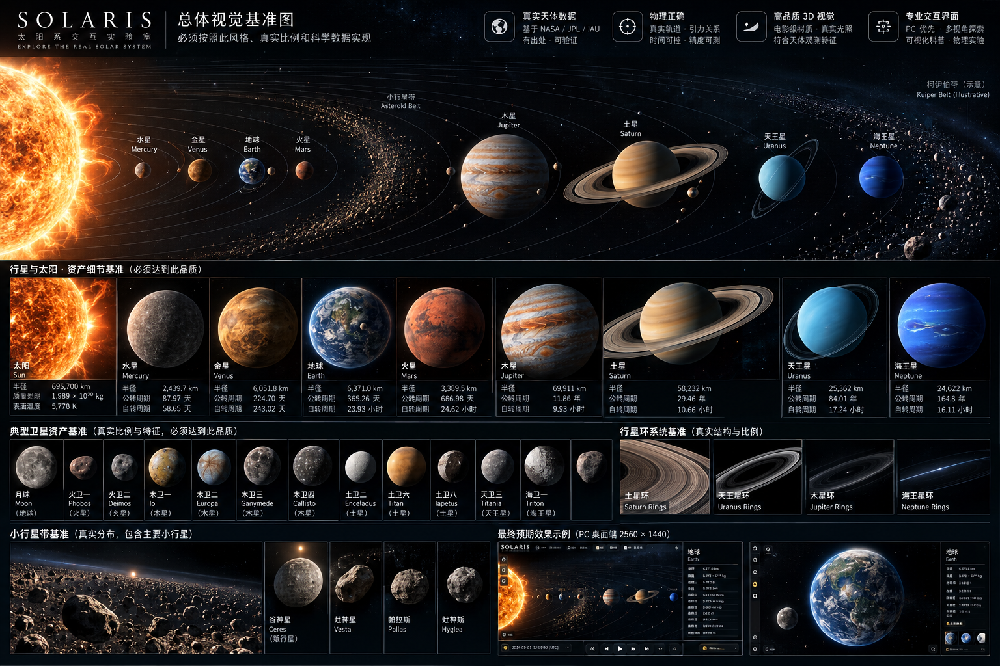
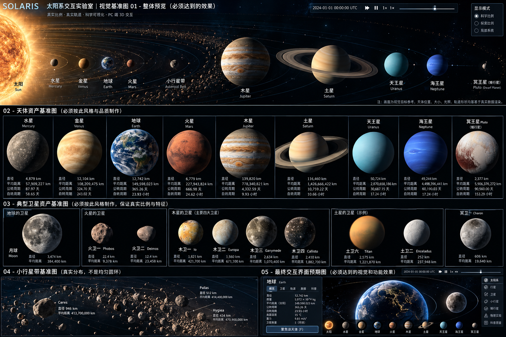

# 视觉与资产冻结 v0.1

## 参考图已纳入文档

原图是生成式概念设计。仅采用构图语言、光照层次、材质细节目标及 UI 密度，不采信任何图中文字数值、轨道、数量、位置、尺寸关系或天体颜色为定量事实。不将截图中的球体、环或背景裁剪成素材。

## 设计决策

| 维度 | 参考图提取的方向 | 冻结规范 |
| --- | --- | --- |
| 主场景 | 沉浸式深色空间、大幅天体、斜俯视轨道 | 3D 视口占满工作区；不做卡片式 Dashboard；总览与聚焦镜头独立 |
| 构图 | 光源在左，天体跨画面延伸 | 后续按真实星历布置天体，相机求构图，不能移动科学位置凑排布 |
| 色彩 | 暖太阳与冷空间对比 | 背景 #050A10，主字 #E4EBF0，辅助 #8F9DAA，强调 #D5BD94；不得把每个天体都打暖光 |
| 光照 | 日夜面明确、有限轮廓与光晕 | 线性照明计算、sRGB 输出；基线 ACES filmic/exposure 1；太阳是主要光源；Bloom 后续只作用发光层并限幅 |
| 材质 | 岩质表面、云带、大气与颗粒环可区分 | 固体天体按地形数据；气态巨行星用云带/大气模型，不铺岩石法线；日冕独立透明层并标注可见度增强 |
| UI | 纤细边线、克制面板、清晰中文 | Segoe UI / 微软雅黑；常规字至少 12–14 CSS px；科学数据采用等宽数字；键盘焦点可见 |
| 布局 | 时间栏、边缘工具、聚焦详情 | 2560×1440 主设计；头栏112px、左轨104px、底栏76px；内容不遮挡焦点；第0期仅必要状态与重置按钮 |
| 标记 | 双语标签、低亮轨迹 | 科学数值带单位/来源入口，轨道线服从所选时间，遮挡与标签避让后续实现 |

第 0 期不加载星空图、不添加行星占位球、圆轨道、假时间或看似可用的控件。原生 CSS 仅做低强度边缘色光，不表达太阳位置。右侧参数是设计约定，明确注明无历表。

## PC 质量档位（预算，非已测能力）

| 档位 | DPR 上限 | 单天体可见纹理目标 | 阴影/后期 | 预算/降级 |
| --- | --- | --- | --- | --- |
| 低 | 1 | 1K–2K | 无 Bloom，单层基础材质 | 1080p 目标30 FPS；优先清晰文字 |
| 标准（空壳默认） | 1.5 | 2K–4K 分层加载 | 克制后期，按需阴影 | 1440p 目标60 FPS；LOD→阴影→分辨率顺序降级 |
| 高 | 2 | 4K–8K 近景按需，预压缩 | 高质量大气/环透明 | 4K 先测设备，不承诺60 FPS |

纹理像素数是加工预算，不代表存在合格源图；没有高分辨率来源就限制镜头，不伪造细节。内存预算初值：标准纹理256 MiB、高512 MiB；统计真实 GPU 格式、mipmap、可见集，不能按 PNG 文件大小估算。4K 本期仅验证空壳布局，不能外推正式场景性能。

## 独立资产台账

机器可读清单见 `data/asset-manifest.json`：太阳、八行星逐项，地月、火卫一二、木星四大、土卫六/二、卡戎优先，土卫八/天卫三/海卫一候选；谷神星/冥王星等矮行星与代表小行星、四大行星环系、小行星统计带/外围示意各独立记录。

所有正式资产当前为 `planned`，无本地文件、无获准许可、无批准版本。每项未来必须填写：官方产品 URL/产品 ID、版权人和署名、许可原文地址、下载时间、版本、原文件哈希、观测年代、投影/经纬方向/色彩处理/缺测处理、衍生文件哈希与工具版本、LOD、审查状态。NASA 通用政策不能代替单张图权利核验。[NASA 媒体政策](https://www.nasa.gov/nasa-brand-center/images-and-media/)

表面地图优先寻找有出处的 NASA/USGS 2:1 经纬图；2:1 并不自动证明正确投影。不规则小天体优先任务形状模型与科学贴图，不能强行球面化。金星可见光云层与雷达地表分层标注。木星/土星等云纹不冒充永久地貌。土星环按径向光学厚度构建，木/天/海王星暗环允许增强但须显示标识。环系数据见 [NASA PDS](https://pds-rings.seti.org/)。

## 当前截图差异与修正边界

第 0 期截图见验收索引。相对参考图，已落实暗空间、暖冷克制色彩、边缘布局与中文可读性；天体、轨道、纹理、环系、小行星、时间线和科普全部缺席。这是分期边界，不视为已达成图中高保真效果。后续按第1期真实位置→第2期材质→第3期局部系统逐项修正，不能为了画面相似先塞假数据。
