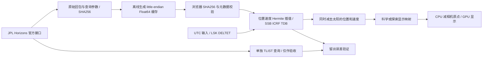

# 第 1 期工程与科学实现

日期：2026-10-29（Asia/Shanghai）。用户明确授权第1期；附件中的第2期及后续内容仅作边界，不作为本次开发任务。

## 第 0 期审计与保护

第0期留下的是 Vite/TypeScript/Three.js 空场景、科学类型/Schema、来源与资产计划和验收证据。无 React/R3F/状态库、无实际星历或时标转换器。保留既有工程、依赖、色彩、桌面布局方向和数据隔离约定，没有恢复旧命运领域模型。UI 壳升级为目录/三维视口/详情/时间栏，核心计算独立于 Three.js。

阶段分支为 `codex/solaris-phase-1`。原第0期验收包仍在 deliverables，未覆盖。开始前暂存树检查点为 `045b944c97ff7574e3bbd9ab40245833ded22212`，另存 `phase0-checkpoint-tree.txt`；这是真实 Git tree 对象，**不是 commit SHA**。当前无作者身份，未伪造作者或改全局配置；最终文件暂存并提供相对该树的差异，不声称已 commit/push。

## 模块职责与差异

| 模块 | 第0期 | 第1期实际实现 |
| --- | --- | --- |
| `src/science/catalog.ts` | 无数值 | 九个本体中心、JPL平均半径/周期；逐字段溯源另存catalog-provenance |
| `src/science/time.ts` | 类型约定 | UTC严格校验、LSK DELTET转换、基于单调实时时钟锚点的模拟时间控制 |
| `src/science/ephemeris.ts` | 无 Provider | 数据完整性与元数据验证、三次Hermite位置/解析导数速度、禁止外推、日心状态相减 |
| `src/science/coordinates.ts` | 展示策略类型 | 科学/探索映射、CSPICE固定显示轴变换、CPU相机相对坐标 |
| `src/render/scene.ts` | 空场景 | 九球、朝日照明、历表路径、标签避让、自由相机、平滑聚焦与总览 |
| `src/render/textures.ts` | 无资产 | 原创确定性基础材质、示意星空/太阳光晕；地球加载NASA历史合成图 |
| `src/main.ts` | 重置空相机 | 目录/搜索、选中详情、来源面板、播放/日期/倍率/比例、键鼠、只读QA快照 |
| `scripts/build-ephemeris.py` | 无 | 官方数据采集、原样归档、F64缓存、独立TLIST留出查询、LSK/CSPICE参数 |
| 测试/文档 | 第0期边界检查 | 科学误差、时间/坐标/模式边界、双浏览器交互与故障注入、录屏、性能证据 |

## 科学数据路径

九个目标经官方手册和回包头逐项确认：10、199、299、399、499、599、699、799、899。解版本分别见 `public/data/manifest.json`，包括 DE441、mar099、jup365_merged、sat441l、ura184_merged、nep098_merged。没有以1–8系统质心替换本体。真实状态原点0、ICRF/FRAME、几何状态NONE，单位km/km/s，TDB自J2000秒。科学读数从这些状态计算，画面大小不参与计算。

依据：[Horizons目标/坐标手册](https://ssd.jpl.nasa.gov/horizons/manual.html)、[官方API参数](https://ssd-api.jpl.nasa.gov/doc/horizons.html)。实际回包API签名为1.2，与当前网页文档1.3的版本分别记录，不混同。每目标保留完整查询、下载时间、采样间隔、覆盖、解版本与原/加工文件哈希。

## 时间与覆盖

实际开放：2024-01-01 00:00:00 — 2031-01-01 00:00:00 UTC；底层TDB网格额外覆盖前后一天。相对附件建议的2020–2035缩小范围，UI与报告一致。太阳24h，水星及木/土/天/海中心6h，金/地/火12h；外行星本体中心受卫星影响，不能只因公转慢就盲目粗采样。69102条状态，二进制3869712字节，浏览器本地加载，不按帧请求网络。

时间使用下载的 `naif0012.tls` 参数，浏览器迭代实现 NAIF DELTET 周期项，与 SpiceyPy 8.3.0 / CSPICE 独立对照。采用JS number双精度，禁止UTC直接等同TDB；`Date`只用于UTC日历与毫秒编码。未来沿用LSK最后已知TAI−UTC，不预测新闰秒，不能用于精确事件预报。未来发布闰秒需更新内核、重生成缓存与重测。超范围、无时区、非法日历及闰秒字面量明确拒绝。[NAIF时间系统](https://naif.jpl.nasa.gov/pub/naif/toolkit_docs/C/req/time.html)

暂停不订阅“每帧加角度”。模拟UTC由实时时钟锚点、模拟时间锚点与倍率计算，倍率切换先结算原倍率再重锚。跳转/重置与全体天体共用同一TDB时刻。正/反/零倍率、边界钳制与暂停均有测试。

## 显示变换与轨迹

科学模式：所有尺寸与距离使用 `AU/52 km` 每场景单位，无最小天体半径；远处小球不可见是比例本身的结果，使用标签/目录聚焦。探索模式：`r'=52 ln(1+r/(0.35 AU))`，方向保持；太阳半径24单位，其他为 `4.2+8.8 sqrt(radiusKm/69911)`，每个天体实际显示增益在来源面板可查。是第0期“独立尺寸增益”策略的明确细化；不改变星历状态，非线性路径不宣称是几何开普勒椭圆。AU换算来自[IAU定义](https://iauarchive.eso.org/public/themes/measuring/)。

显示轴由CSPICE `pxform(J2000,ECLIPJ2000,0)` 导出后转Three.js Y-up；这是一项固定显示约定，不改原始ICRF状态，也不将ICRF误称为黄道系。CPU先计算日心/显示坐标，再减导航相机原点，GPU只接受局部Float32；渲染相机位于0并同步姿态。对数深度缓解全局与近景尺度跨度。物理实验尚未实现，科学状态没有实验写入口。

轨迹是2024–2031整窗的历史/未来日心历表采样，内行星可能包含多圈；采样间隔为水星1天、金/地2天、其余4天，仅用于显示折线，不等于状态缓存步长。外行星弧段不补圆、不闭合、不伪装165年精确轨道。图例常驻说明含义与时间窗。显示轨迹不用于误差测量或事件预测。

## 相机和材质边界

左键选中、双击聚焦、拖动旋转、滚轮缩放，Space/F/Esc可操作；输入框隔离快捷键。科学与探索各有全局镜头。聚焦视图暂隐其他天体/轨迹以避免尺寸放大遮挡，有可见提示；返回恢复全场。聚焦转场随所选天体移动，不改真实位置。

地球是NASA SVS 2915的2048×1024经纬合成图，原文件未修改，来源/署名/政策/哈希在 `data/phase-1/visual-assets.json`。其余程序材质不冒充科学影像。日夜半球由太阳方向决定；补光、太阳光晕为可读性增强，不是光度定标。所有表面朝向尚未接入姿态历表，不把地表日夜分布冒充真实地理昼夜预测。无自转角累加、卫星、粒子带或正式环系。[NASA产品页](https://svs.gsfc.nasa.gov/2915)、[使用政策](https://www.nasa.gov/nasa-brand-center/images-and-media/)

具体误差、浏览器、性能与视觉证据见02/03报告。本期实现到此冻结，不进入第2期。

收尾工程修正：为消除Vite开发服务关于public静态目录导入的警告，将打包使用的清单写入 `data/phase-1/manifest.json`，公开溯源副本仍在 `public/data/manifest.json`。科学检查强制两份JSON一致。该路径修正后生成的生产JS仍为 `index-BB9YMYFa.js`、CSS仍为 `index-pv2tK_Xj.css`，与最终布局验收时加载的资源相同。开发服务另作启动/控制台烟测。
